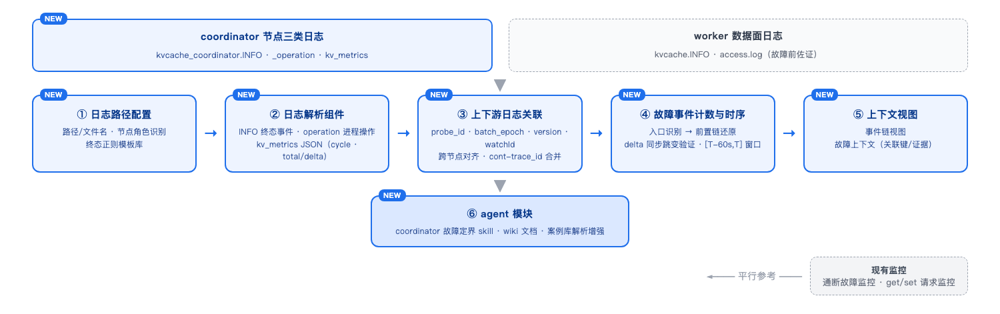

# KVCache Coordinator 故障定位功能设计

> 适用范围：灵衢 KVCache 部署中由中心管理节点（coordinator pod）承担的管控面功能。本指南整理 coordinator 主要业务流、各业务流故障时的**终态入口关键字**（可直接用于正则匹配），以及故障上下文的获取与相关性确认方法。
>
> 日志真实格式取自演练场景 `1022/coordinator/zzz-coodinator-0/`（2026-10-14 数据），源码位置对应 `yuanrong-datasystem/src/datasystem/`。

---

## 0. 功能设计总览

> 目标：在 witty-ub 现有**通断故障监控**与 **get/set 请求监控**基础上，平行新增 **coordinator 故障定界**能力——对中心管理节点日志做解析、关联、计数与时序分析，并为 agent 模块提供 skill/wiki/案例支撑。



### 0.2 基本功能清单与对应技术点

| # | 基本功能 | 主要技术点 | 对应章节 |
|---|---|---|---|
| 1 | coordinator 日志路径配置 | 三类日志文件识别（INFO/operation/metrics）、节点角色识别（仅中心管理节点打印）、终态正则模板库 | §1、§3 |
| 2 | 日志解析组件 | INFO 终态事件解析（正则命中入口）、operation 进程操作解析（重启/配置排除）、kv_metrics JSON 解析（按 cycle 合并 part 分片，total/delta 提取） | §1、§4.1 |
| 3 | 上下游日志关联组件 | 硬性线索关联模型（probe_id/batch_epoch/version/watchId/coordinator_id）、跨节点故障前对齐（cluster+时间戳）、cont-trace_id 线程合并 | §5.1~§5.6 |
| 4 | 故障事件计数与时序 | 入口事件识别（终态正则）、前置事件链还原（业务流全链路）、delta 同步跳变验证（e2e_fail_latency/watch_failure/channels）、两段式前向窗口 [T-60s, T] | §2、§4.1、§4.2 |
| 5 | 上下文视图 | 事件链视图（B1~B7 业务流全链路）、故障上下文展示（关联键/窗口/证据） | §4、§5 |
| 6 | agent skill | coordinator 故障定界 skill（终态正则 + 关联模型落地为可执行流程） | §3、§5 |
| 7 | wiki | 本文档（业务流/终态入口/上下文获取/关联线索） | 全文 |
| 8 | 案例库解析增强 | 现有演练案例补充 coordinator 故障链解析（入口 → 前置链 → 定界结论） | §2、§3 |

---

## 1. 日志文件与打印位置

| 文件 | 打印进程 | 内容 | 级别 |
|---|---|---|---|
| `kvcache_coordinator.INFO.log` | 仅 coordinator 进程（中心管理节点） | 管控面全部操作过程与故障事件（`CLUSTER_*`/`COORDINATOR_*` 前缀） | INFO/WARNING/ERROR |
| `kvcache_coordinator_operation.log` | 仅 coordinator 进程 | 进程级关键操作：`OPERATION_START`/`VERSION_INIT`/`CONFIG_INIT` | 结构化 |
| `kv_metrics.log` | 仅 coordinator 进程 | 每 10s 一次 JSON 指标快照（RPC 计数/延迟/watch 通道） | JSON 行 |
| `kvcache.INFO.log` + `access.log` | worker 进程（数据节点） | 数据面日志（客户端注册、fd 传递、POSIX 访问），不含 `CLUSTER_*` 协调事件 | INFO/WARNING |

行格式（INFO 日志，每行一个事件）：

```
2026-10-14T17:08:39.282404 | W | topology_controller.cpp:2111 | zzz-coodinator-0 | 308:468 | cont-b0472c1a-... |  |  CLUSTER_FAILURE cluster=zzz-kv-ds-1 action=plan ... outcome=start_pending
时间戳 | 级别 | 源文件:行号 | pod | pid:tid | 线程名;trace_id | 事件
```

---

## 2. Coordinator 主要业务流总览

| # | 业务流 | 正常过程事件链（从左到右） |
|---|---|---|
| B1 | 选主与 Bootstrap | `COORDINATOR_RAFT_METADATA_ABSENT` → `COORDINATOR_RAFT_START_PLAN` → `COORDINATOR_RAFT_LEADER_ELECTED` → `COORDINATOR_RAFT_CONFIGURATION_COMMITTED` |
| B2 | 集群拓扑恢复 | `CLUSTER_RECOVERY_STATE new=RECOVERING` → `CLUSTER_RECOVERY_CANDIDATE`/`PAYLOAD_ACCEPTED` → `CLUSTER_RECOVERY_STATE new=INSTALLING` → `CLUSTER_RECOVERY_READY` |
| B3 | 成员注册与租约保活 | `CLUSTER_KV_CHANGE event_type=0 key=.../cluster/<addr>`（注册）→ 保活续期（VLOG）→ `CLUSTER_RECOVERY_READY_STORED_AUTHORITY` |
| B4 | Watch 注册与事件分发 | `CLUSTER_WATCH_REGISTERED`（worker 侧）→ `CLUSTER_DERIVED_STATE action=generation_complete` → watch 事件推送（VLOG） |
| B5 | 故障检测与隔离 | `CLUSTER_KV_CHANGE event_type=1`（成员 key TTL 删除）→ `CLUSTER_FAILURE_DETECT action=missing_first_observed` → `WITNESS_PROBE_ROUND_STARTED` → `CLUSTER_WORKER_PROBE WITNESS_PROBE_REPORT_RECEIVED` → `WITNESS_PROBE_FAILURE_ALLOWED` → `CLUSTER_FAILURE action=plan outcome=start_pending` → `outcome=finalizing` → `outcome=finalized` |
| B6 | 拓扑变更下发与任务执行 | `CLUSTER_FAILURE ... outcome=finalized` / `CLUSTER_CHANGE_BATCH action=start batch_type=FAILURE/SCALE_OUT` → `CLUSTER_RING role=controller status=cas_committed version=N` → `CLUSTER_CHANGE_BATCH action=deadline_set` → `action=finalized committed_version=N+1` |
| B7 | 控制主机生命周期 | `CLUSTER_CONTROL_HOST state=started` → `state=running cluster=<c>` → `state=stopping/stopped` |

---

## 3. 各业务流故障入口关键字（终态，可直接正则）

> 原则：以下关键字均为**终态事件**——出现即代表该业务流确定发生了故障/异常收敛，可直接作为判定入口。中间态事件（见 §3.8）不能单独判定故障，只用于取上下文。

### 3.1 B1 选主与 Bootstrap

| 正则模板 | 级别 | 源码位置 | 判定含义 |
|---|---|---|---|
| `COORDINATOR_RAFT_BOOTSTRAP_TERMINAL group_id=` | ERROR | coordinator/raft/coordinator_election_manager.cpp:1320 | bootstrap 终态失败，进程将终止 |
| `Coordinator Raft bootstrap has not converged` | W | coordinator/raft/coordinator_election_manager.cpp:1351 | bootstrap 长期未收敛（周期性告警，需结合出现时长） |
| `COORDINATOR_RAFT_LEADER_STOPPED current_addr=` | W | coordinator/raft/coordinator_election_manager.cpp:1123 | 丢失 leadership（终态） |
| `COORDINATOR_RAFT_EXISTING_MEMBER_WITHOUT_LOCAL_DATA current_addr=` | W | coordinator/raft/coordinator_election_manager.cpp:785 | 被确认为既有成员但本地数据缺失（终态阻塞） |
| `Coordinator membership status reconciliation failed` | W | coordinator/raft/coordinator_membership_manager.cpp:262 | 成员列表调和失败 |

### 3.2 B2 集群拓扑恢复

| 正则模板 | 级别 | 源码位置 | 判定含义 |
|---|---|---|---|
| `CLUSTER_RECOVERY_FORCED_READY cluster=` | W | coordinator/topology_recovery_manager.cpp:370 | 硬期限/冲突强制就绪（可能丢失权威拓扑，终态异常） |
| `CLUSTER_RECOVERY_CONFLICT, cluster=` | W | coordinator/topology_recovery_manager.cpp:1428 | 多个最高版本候选冲突（分裂大脑风险，终态） |
| `CLUSTER_RECOVERY_INVALID_HIGHEST_CANDIDATE, cluster=` | W | coordinator/topology_recovery_manager.cpp:948 | 最高版本候选校验无效，进入 BLOCKED |
| `CLUSTER_RECOVERY_STORED_AUTHORITY_INVALID cluster=` | E | coordinator/topology_recovery_manager.cpp:1401 | 已存储权威拓扑解码失败，进入 BLOCKED |
| `CLUSTER_RECOVERY_INSTALL_FAILED_AT_HARD_DEADLINE, cluster=` | W | coordinator/topology_recovery_manager.cpp:1530 | 硬期限到达时安装失败 |
| `CLUSTER_RECOVERY_INSTALL_BLOCKED, cluster=` | W | coordinator/topology_recovery_manager.cpp:1537 | 安装校验无效，进入 BLOCKED |
| `CLUSTER_RECOVERY_RECONCILE_FAILED, cluster=` | W | coordinator/topology_recovery_manager.cpp:989 | 恢复调和（finalize/安装决策）失败 |
| `CLUSTER_RECOVERY_MEMBER_LIMIT_REACHED, cluster=` | W | coordinator/topology_recovery_manager.cpp:455 | 成员数超恢复期上限，拒绝接纳 |
| `CLUSTER_RECOVERY_REPORT_REJECTED, cluster=` | W | cluster/coordination_backend/topology_recovery_reporter.cpp:287 | worker 上报被 leader 拒绝（worker 侧日志） |
| `CLUSTER_RECOVERY_REPORT_FAILED cluster=` | E | cluster/coordination_backend/topology_recovery_reporter.cpp:186 | worker 上报循环异常（worker 侧日志） |

### 3.3 B3 成员注册与租约保活

| 正则模板 | 级别 | 源码位置 | 判定含义 |
|---|---|---|---|
| `Confirmed local Coordinator network isolation; keep the process alive` | W | cluster/coordination_backend/ds_coordination_backend.cpp:1177 | worker 判定与 coordinator 网络隔离（worker 侧日志，终态判定） |
| `WORKER_LEADER_ENSURE_REJECTED cluster=` | E | cluster/coordination_backend/worker_leader_reconciler.cpp:325 | 成员 ensure 被拒且不可重试（STALE_EPOCH/INVALID，终态） |
| `CLUSTER_MEMBERSHIP_RECONCILE_SCHEDULE_FAILED` | W | cluster/coordination_backend/ds_coordination_backend.cpp:1186 | 保活遇 K_NOT_FOUND/K_TRY_AGAIN 时重协调调度失败 |
| `CLUSTER_MEMBERSHIP role=worker action=initial_keepalive_retry` | W | cluster/coordination_backend/ds_coordination_backend.cpp:647 | 启动期 leader 不可达持续重试（**中间态**，需结合 `attempt=` 或持续时长判断） |

### 3.4 B4 Watch 事件分发

| 正则模板 | 级别 | 源码位置 | 判定含义 |
|---|---|---|---|
| `CLUSTER_WATCH_PENDING_FULL droppedEvents=` | W | common/coordinator/watch_dispatcher.cpp:84 | 待分发队列打满，**丢弃事件**（终态） |
| `CLUSTER_WATCH_BACKPRESSURE_OVERFLOW watchId=` | W | common/coordinator/watch_dispatcher.cpp:342 | 单 watcher 背压溢出，清队列并触发 REWATCH 重置（终态） |
| `CLUSTER_WATCH_NOTIFY_FAILED watchId=` | W | common/coordinator/watch_dispatcher.cpp:551 | 推送事件 RPC 失败（worker 不可达/超时，终态） |
| `CLUSTER_WATCH_CANCEL_FAILED watchId=` | W | common/coordinator/watch_dispatcher.cpp:150/190 | 取消 watch 注册失败 |
| `CLUSTER_WATCH_REBUILD_CANCEL_FAILED watchId=` | W | common/coordinator/watch_dispatcher.cpp:583 | REWATCH 重置时取消旧 watch 失败 |
| `CLUSTER_COMMITTED_MUTATION_OBSERVER_FAILED, error=` | W | common/coordinator/coordinator_store.cpp:61 | 已提交变更观察者回调异常 |
| `CLUSTER_WATCH_EVENT_ENQUEUE_FAILED, error=` | W | common/coordinator/coordinator_store.cpp:71 | watch 事件入分发队列异常 |

### 3.5 B5 故障检测与隔离（核心定界链）

| 正则模板 | 级别 | 源码位置 | 判定含义 |
|---|---|---|---|
| `CLUSTER_FAILURE_DETECT .*action=WITNESS_PROBE_FAILURE_ALLOWED` | W | cluster/control/topology_controller.cpp:1561 | **探活裁决通过**：允许判定 target 故障（终态入口） |
| `CLUSTER_FAILURE cluster=.*action=plan .*outcome=start_pending` | W | cluster/control/topology_controller.cpp:2111 | 故障处置计划启动（终态入口） |
| `CLUSTER_FAILURE cluster=.*outcome=finalizing` | I | cluster/control/topology_controller.cpp:2553 | 进入定案流程（中间态，与 finalized 成对） |
| `CLUSTER_FAILURE cluster=.*outcome=finalized .*failed_count=[1-9][0-9]* .*committed_version=[0-9]+` | I | cluster/control/topology_controller.cpp:2576 | **故障定案**：节点正式判 FAILED 并落版（终态） |
| `CLUSTER_WORKER_PROBE cluster=.*action=WITNESS_PROBE_REPORT_RECEIVED .*result=UNREACHABLE` | I | coordinator/coordinator_service_impl.cpp:1338 | witness 判 target 不可达（故障证据，终态事实） |
| `CLUSTER_CONTROL_HOST action=reconcile_exception status=` | E | coordinator/topology_control_host.cpp:739/741 | 控制主机调和循环异常 |
| `CLUSTER_CONTROL_HOST cluster=.*state=start_failed action=bounded_stop` | E | coordinator/topology_control_host.cpp:863 | 集群 runtime 启动失败并限时停止 |
| `CLUSTER_FAILURE_DETECT .*action=missing_first_observed` | W | cluster/control/topology_controller.cpp:1041 | 节点首次缺失（**中间态**：可能被后续 REACHABLE 消除） |
| `CLUSTER_FAILURE_DETECT .*action=WITNESS_PROBE_FAILURE_BLOCKED` | W | cluster/control/topology_controller.cpp:1556 | 证据不足暂不判定（**中间态**：等待更多探活轮） |

### 3.6 B6 拓扑变更下发与任务执行

| 正则模板 | 级别 | 源码位置 | 判定含义 |
|---|---|---|---|
| `CLUSTER_COORDINATOR_STORE_CAS action=retry_exhausted key=` | W | coordinator/coordinator_store_backend.cpp:298 | CAS 冲突重试耗尽（并发写冲突持续，终态） |
| `CLUSTER_CHANGE_BATCH cluster=.*action=deadline_reached` | W | cluster/control/topology_controller.cpp | 批处理期限内未收敛，期限到达（终态异常；如未出现则核对 `finalized`） |
| `CLUSTER_RING cluster=.*role=controller status=cas_committed version=[0-9]+ .*state=FAILED` | I | cluster/control/topology_controller.cpp:2843 | 新环含 FAILED 节点（配合 B5 确认） |
| `CLUSTER_CHANGE_BATCH cluster=.*action=finalized .*committed_version=[0-9]+` | I | cluster/control/topology_controller.cpp:2559 | 变更批完结（正常终态，用于上下文闭环确认，本身非故障） |

### 3.7 B7 控制主机生命周期

| 正则模板 | 级别 | 源码位置 | 判定含义 |
|---|---|---|---|
| `CLUSTER_CONTROL_HOST state=shutdown_incomplete action=retain_dependencies` | W | coordinator/coordinator_service_impl.cpp:917 | 未能在宽限期内完成关停 |
| `CLUSTER_CONTROL_HOST cluster=.*state=stopping reason=` | I | coordinator/topology_control_host.cpp:916 | 集群 runtime 停止（需看 reason 判定是否异常：`recovery_state` 非 READY / `runtime_error` 非空为异常） |
| `Coordinator runtime error:` | E | coordinator/coordinator_main.cpp:34 | 主程序 InitAndRun 返回错误（进程退出终态） |
| `CLUSTER_RECOVERY_MANAGER_SHUTDOWN_FAILED, status=` | W | coordinator/coordinator_service_impl.cpp:910 | 恢复管理器关停失败 |

### 3.8 中间态/正常态清单（防误判，不作为故障入口）

| 事件 | 级别 | 说明 |
|---|---|---|
| `COORDINATOR_RAFT_METADATA_ABSENT` / `START_PLAN` / `LEADER_ELECTED` | I | 选主正常过程 |
| `CLUSTER_RECOVERY_STATE old=UNSEEN new=RECOVERING` / `new=INSTALLING` / `CLUSTER_RECOVERY_READY` / `CLUSTER_RECOVERY_READY_STORED_AUTHORITY` | I | 拓扑恢复正常过程/成功态 |
| `CLUSTER_FAILURE_DETECT .*action=missing_first_observed` | W | 仅嫌疑开始，后续 `missing_resolved`/`WITNESS_PROBE_REPORT_RECEIVED result=REACHABLE` 可消除 |
| `CLUSTER_FAILURE_DETECT .*WITNESS_PROBE_FAILURE_BLOCKED` | W | 证据不足暂保留，等待更多探活轮 |
| `CLUSTER_FAILURE_DETECT .*WITNESS_PROBE_ROUND_CLEARED reason=TARGET_NO_LONGER_SUSPECT` | I | 嫌疑被解除（正常恢复） |
| `CLUSTER_CHANGE_BATCH action=deadline_set window_ms=30000` | I | 设定批处理期限（正常） |
| `CLUSTER_CHANGE_BATCH action=scaleout_collect_start` | I | 扩容收集开始（正常） |
| `CLUSTER_KV_CHANGE event_type=0 key=.../cluster/<addr>` | I | 成员注册（正常） |
| `CLUSTER_COORDINATOR_ID role=coordinator id=` | I | 进程代际标识（正常） |

---

## 4. 故障上下文获取方法

### 4.1 本节点（coordinator pod）展开

1. **确定入口（最终故障结果）**：用 §3 的终态正则扫 `kvcache_coordinator.INFO.log`，命中行即**最终故障结果**（如 `outcome=finalized`、`FORCED_READY`、`NOTIFY_FAILED`），记其时间 `T`。
2. **取时间窗（只取故障前）**：`[T-60s, T]`——只取**入口事件本身 + 其之前**的日志，用于还原"导致该最终结果的前置链路"。故障后的日志不属于本流程（如需验证处置闭环/连锁影响，再另行向后扩展）。
3. **串事件链**：在 `[T-60s, T]` 窗口内过滤 `CLUSTER_*`/`COORDINATOR_*`，按时间排序，用 §2 的事件链还原从缺失观察到定案的前置过程（这些事件全部发生在入口之前，如 `missing_first_observed` → `WITNESS_PROBE_ROUND_STARTED` → `REPORT_RECEIVED` → `FAILURE_ALLOWED` → `finalized`）。
4. **量化验证**：`kv_metrics.log` 按 `cycle` 对齐 `[T-60s, T]` 窗口，比对 delta 字段是否同步跳变：
   - `brpc_rpc_e2e_fail_latency` delta>0 或 `coordinator_watch_rpc_failure_total` delta>0 → 故障窗口确认在 coordinator 侧；
   - 三份指标均无跳变而业务仍失败 → 问题在下游/网络，coordinator 仅是目击者。
5. **排除进程底色**：`kvcache_coordinator_operation.log` 中确认 `T` 之前无新的 `OPERATION_START`（进程未重启），`CONFIG_INIT` 中的 `node_dead_timeout_s`/`enable_ub_fault_isolation` 与故障表现匹配。

### 4.2 跨节点佐证（仅取故障前/入口时刻）

在"只关注故障前"的视角下，worker 节点日志用于佐证**故障前的事实**，帮助排除"该节点本就异常"的干扰：

| 核对环节 | 日志关键字（时间 < T 或入口时刻） | 佐证内容 |
|---|---|---|
| 故障前已注册 | coordinator 侧 `CLUSTER_KV_CHANGE event_type=0 key=.../cluster/<addr>` | 故障节点在 T 之前已正常注册为成员 |
| 故障前数据面存活 | worker 侧 `kvcache.INFO.log` 的 `Register client` / `object_posix` | 故障前该节点数据面正常服务 |
| 探活裁决证据 | `CLUSTER_WORKER_PROBE ... action=WITNESS_PROBE_REPORT_RECEIVED ... result=UNREACHABLE/REACHABLE`（入口时刻） | 定案依赖的探活事实 |

> 注：故障后的处置结果（如 rejoin、SCALE_OUT、拓扑 published）不属于本流程范围，不再核对。

---

## 5. 上下文相关性确认线索（判断事件属于同一故障）

> 核心：**只把共享同一"关联键"的事件视为同一故障的上下文；关联键不同的事件属于其他业务过程，必须排除。**

### 5.1 关联键清单

| 关联键 | 在日志中的字段形式 | 用途 |
|---|---|---|
| `cluster` | `cluster=zzz-kv-ds-1` | 标识故障所属集群，**首要过滤条件** |
| `target` + `target_id_prefix` | `target=192.168.235.129:31501 target_id_prefix=ff84ffb3-a69` | 标识故障目标节点，同节点事件串链 |
| `probe_id` | `probe_id=61c884fc-...-4294967297` | 标识一次探活轮次，同探活链路的关联锚点（CLEARED 后新 probe_id 为新一轮） |
| `version` / `committed_version` | `version=18` / `committed_version=19` | 标识拓扑版本，`CLUSTER_FAILURE finalized committed_version=19` ↔ `CLUSTER_RING version=19` ↔ `CLUSTER_CHANGE_BATCH committed_version=19` 三处必须一致 |
| `batch_epoch` | `batch_epoch=18` | 标识一次变更批，与 `batch_type`（FAILURE/SCALE_OUT/SCALE_IN）配合 |
| `watchId` | `watchId=10` | 标识 watch 通道，`NOTIFY_FAILED`/`BACKPRESSURE_OVERFLOW`/`CANCEL_FAILED` 同 watchId 关联 |
| `coordinator_id` | `coordinator_id=61c884fc` | 标识 coordinator 进程代际，跨代际事件属不同生命周期 |
| `trace_id` | 行尾 `cont-xxx;b0472c1a-...` | 线程内事件串联（仅本进程内有效，**不能跨节点**） |
| 时间戳 | `2026-10-14T17:08:39.282` | 跨节点对齐用，精度到秒即可 |

### 5.2 各业务流专属主键（关联逻辑因业务流而异）

> 通用主键覆盖所有流，但**每个业务流还有自己的专属主键**——串链时必须先判断事件属于哪个业务流，再选用对应主键。这些主键均为单调递增/唯一，同值必属同一业务过程。

| 业务流 | 专属主键 | 递增规则 | 生命周期 | 关联链示例 |
|---|---|---|---|---|
| B1 选主/bootstrap | Raft `term` + `index`、`group_id` | 选举次数 term+1；日志 index+1 | 稀疏（换届才变） | `LEADER_ELECTED term=N` ↔ `LEADER_STOPPED term=N` ↔ Raft 回调事件 `term=N index=...` |
| B2 拓扑恢复 | `version` + `store_revision` | version 落版+1；store_revision 每 KV 写+1 | 恢复期（秒~分钟） | `RECOVERY_CANDIDATE version=17` → `READY version=17` → `READY_STORED_AUTHORITY store_revision=44` |
| B3 成员/保活 | **成员 key** + KV `revision` | 同一节点 key 的 revision 单调递增 | 常驻 | `CLUSTER_KV_CHANGE key=.../cluster/<addr> revision=9` → 同 key 后续 put/delete 用 revision 续链 |
| B4 watch | `watchId` + `revision` | watch 注册时 id+1；rewatch 从某 revision 续 | 通道生命周期 | `NOTIFY_FAILED watchId=10` ↔ `BACKPRESSURE_OVERFLOW watchId=10` ↔ `CANCEL_FAILED watchId=10` |
| B5 故障检测 | `probe_id`（尾号递增） | 每探活轮 **+1** | 短命（秒级，CLEARED 后失效） | `ROUND_STARTED probe_id=...298` → `REPORT_RECEIVED` → `FAILURE_ALLOWED` 同 298 |
| B6 变更下发 | `batch_epoch`（内嵌任务 key） | 每变更批 **+1** | 中寿（30s~180s） | `CHANGE_BATCH batch_epoch=18` ↔ `tasks/delete/d-e18-...` ↔ `finalized committed_version=19` |
| B7 生命周期 | `coordinator_id` + `state` 迁移 | 无序号，靠状态机 | 进程全程 | `state=started → running → stopping(reason) → stopped` |

**主键生命周期对比（决定"某 id 是否仍有效"）**：`probe_id` 秒级、一轮 `ROUND_CLEARED` 即失效；`batch_epoch` 30s~180s 跨批；`version` 长命、贯穿多个批；`term` 极稀疏。关联方向也不同：探活链是单向轮次（298 结束才能开 299）；变更批是开闭区间（start→finalized）；版本是全局顺序（只增）；成员保活是按 key 回溯。

### 5.3 跨业务流交接键

业务流之间的衔接**只认 `version`**（唯一贯穿多个流的键）：

```
B5 探活链（probe_id=298）→ FAILURE_ALLOWED
   ↓ 交接：outcome=finalized committed_version=19          （B5 结束）
B6 变更批（batch_epoch=18）→ RING cas_committed version=19 → CHANGE_BATCH finalized committed_version=19   （B6 闭环）
   ↓ 交接：RING version=19 ↔ worker 侧 published version=19
B2 恢复/回归（version 续到 20、21）→ 新节点 rejoin（id_prefix 变化）→ 新探活轮（probe_id=299）
```

注意：`probe_id`/`batch_epoch`/`watchId` 不跨流，跨流时只有 `version` 可交接；跨节点时只有 `version` + `cluster` + 时间戳可对齐。

### 5.4 同一故障的确认规则

1. **同 `cluster`**：所有上下文事件必须与入口事件的 `cluster` 一致，不同 cluster 的事件一律排除。
2. **同 `probe_id`**：`WITNESS_PROBE_ROUND_STARTED` → `WITNESS_PROBE_REPORT_RECEIVED` → `WITNESS_PROBE_FAILURE_ALLOWED` 必须共享同一 `probe_id`；出现新的 `probe_id` 表示开启新探活轮（前一轮 `ROUND_CLEARED`），不代表当前故障。
3. **版本闭环**：`CLUSTER_FAILURE ... outcome=finalized committed_version=N` 之后，必须能找到 `CLUSTER_RING ... status=cas_committed version=N` 与 `CLUSTER_CHANGE_BATCH ... action=finalized ... committed_version=N`。**缺任一环 = 变更未真正落地**，即为"决策对、执行漏"的嫌疑点。
4. **同 `target`**：故障对象地址一致（注意新节点 rejoin 后 `id_prefix` 会变，见实例 192.168.235.129:31501 从 `ff84ffb3-a69` 变为 `2e1785d2-c0c`，属同一节点重新入环）。
5. **时间连续性**：同一故障的事件时间单调递增且间隔在流程阈值内（missing→finalized < node_dead_timeout_s 数量级；变更批 window_ms=30000/180000）。

### 5.5 排除规则（判断事件不属于当前故障）

| 情况 | 判定 |
|---|---|
| `cluster` 不同 | 完全无关，排除 |
| `probe_id` 不同且前一轮已 `WITNESS_PROBE_ROUND_CLEARED` | 上一轮探活已结束，新一轮嫌疑是独立事件 |
| `coordinator_id` 不同 | 跨 coordinator 换届，需按代际重查上下文 |
| 同一节点 `state=ACTIVE` 的 `CLUSTER_RING`（如 version=17 正常环）与含 `state=FAILED` 的环（version=18）并存 | 前者是变更前快照，后者才是本故障产物；用 `version` 递增确认时间先后 |
| worker 侧 `CLUSTER_RING status=published` 的 `version` 与 coordinator 侧 `committed_version` 不一致 | worker 尚未应用该版本，属"执行滞后/丢失"，需查 `CLUSTER_WATCH_NOTIFY_FAILED` |
| `trace_id` 相同的连续事件 | 同一线程内同一流程，属强相关上下文 |

### 5.6 通用关联路径（4 步法）

> 识别出某业务流故障后，用该流的专属主键关联即可，但**入口事件行可能不带全部主键**（如 `outcome=finalized` 有 `batch_epoch` 但无 `probe_id`），需用中转键回捞补全。

```
① 解析入口行   → 提取所有键字段（batch_epoch / probe_id / watchId / version / target / coordinator_id）
② 同流直连     → 用专属主键 grep，捞该业务流全部事件
③ 中转补全     → 若入口行缺某主键，用 version / target / 成员 key 中转回捞，再提取缺失主键继续
④ 闭环校验     → version 三处一致（FAILURE / RING / CHANGE_BATCH）→ cont-trace_id 合并线程
              → 跨节点用 version + cluster + 时间戳对齐
```

**实例：从 `CLUSTER_FAILURE ... outcome=finalized batch_epoch=18 ... committed_version=19` 入口出发**

| 步 | 动作 | grep 依据 | 捞到什么 |
|---|---|---|---|
| 1 | 同流直连 | `batch_epoch=18` | CHANGE_BATCH 的 start/deadline_set/finalized 三事件 + 任务 key `d-e18-...` + notify 下发 |
| 2 | 版本闭环 | `version=19` / `committed_version=19` | `CLUSTER_RING status=cas_committed version=19`（三处闭环确认落版） |
| 3 | 回溯探活链 | `target=192.168.235.129:31501` 或 `version=17` | 捞回 `missing_first_observed` / `WITNESS_PROBE_ROUND_STARTED` / `REPORT_RECEIVED` / `FAILURE_ALLOWED` |
| 4 | 提取探活主键 | 第 3 步结果中的 `probe_id=...298` | 用 298 再 grep → 确认整条探活链次序完整 |
| 5 | 线程合并 | 各行的 `cont-xxx` | 同一控制循环毫秒级连续事件合并成链 |
| 6 | 跨节点佐证（可选） | `cluster=` + 时间戳（< T） | worker 侧故障前事实（注册/数据面存活），**不做故障后闭环核对** |

**要点**：
- 专属主键能**隔离并行过程**——同时刻其他业务流（其他节点注册、另一批 SCALE_OUT）用主键过滤后自然排除，优于时间过滤；
- **不能只用单键**——完整上下文 = `probe_id`（探活）+ `batch_epoch`（变更批）+ `key+revision`（KV 序列）+ `cont-trace_id`（线程）各层键的并集；
- **跨流必走 `version`**——B5→B6、B6→B2 的交接点都是 `version`。

---

## 附：终态故障入口正则汇总（可直接使用）

```text
# B1 选主/bootstrap
COORDINATOR_RAFT_BOOTSTRAP_TERMINAL group_id=
Coordinator Raft bootstrap has not converged
COORDINATOR_RAFT_LEADER_STOPPED current_addr=
COORDINATOR_RAFT_EXISTING_MEMBER_WITHOUT_LOCAL_DATA current_addr=

# B2 拓扑恢复
CLUSTER_RECOVERY_FORCED_READY cluster=
CLUSTER_RECOVERY_CONFLICT, cluster=
CLUSTER_RECOVERY_INVALID_HIGHEST_CANDIDATE, cluster=
CLUSTER_RECOVERY_STORED_AUTHORITY_INVALID cluster=
CLUSTER_RECOVERY_INSTALL_FAILED_AT_HARD_DEADLINE, cluster=
CLUSTER_RECOVERY_INSTALL_BLOCKED, cluster=
CLUSTER_RECOVERY_RECONCILE_FAILED, cluster=
CLUSTER_RECOVERY_MEMBER_LIMIT_REACHED, cluster=
CLUSTER_RECOVERY_REPORT_REJECTED, cluster=
CLUSTER_RECOVERY_REPORT_FAILED cluster=

# B3 成员/保活
Confirmed local Coordinator network isolation; keep the process alive
WORKER_LEADER_ENSURE_REJECTED cluster=
CLUSTER_MEMBERSHIP_RECONCILE_SCHEDULE_FAILED

# B4 watch 分发
CLUSTER_WATCH_PENDING_FULL droppedEvents=
CLUSTER_WATCH_BACKPRESSURE_OVERFLOW watchId=
CLUSTER_WATCH_NOTIFY_FAILED watchId=
CLUSTER_WATCH_CANCEL_FAILED watchId=
CLUSTER_WATCH_REBUILD_CANCEL_FAILED watchId=
CLUSTER_COMMITTED_MUTATION_OBSERVER_FAILED, error=
CLUSTER_WATCH_EVENT_ENQUEUE_FAILED, error=

# B5 故障检测与隔离（定界核心）
CLUSTER_FAILURE_DETECT .*action=WITNESS_PROBE_FAILURE_ALLOWED
CLUSTER_FAILURE cluster=.*action=plan .*outcome=start_pending
CLUSTER_FAILURE cluster=.*outcome=finalized .*failed_count=[1-9][0-9]* .*committed_version=[0-9]+
CLUSTER_WORKER_PROBE cluster=.*action=WITNESS_PROBE_REPORT_RECEIVED .*result=UNREACHABLE
CLUSTER_CONTROL_HOST action=reconcile_exception status=
CLUSTER_CONTROL_HOST cluster=.*state=start_failed action=bounded_stop

# B6 拓扑变更
CLUSTER_COORDINATOR_STORE_CAS action=retry_exhausted key=
CLUSTER_CHANGE_BATCH cluster=.*action=deadline_reached

# B7 生命周期
CLUSTER_CONTROL_HOST state=shutdown_incomplete action=retain_dependencies
Coordinator runtime error:
CLUSTER_RECOVERY_MANAGER_SHUTDOWN_FAILED, status=
```

> 注：B3 中 `CLUSTER_MEMBERSHIP role=worker action=initial_keepalive_retry`、B5 中 `missing_first_observed`/`WITNESS_PROBE_FAILURE_BLOCKED` 为**中间态**，仅当其与对应终态事件（`WITNESS_PROBE_FAILURE_ALLOWED`/`outcome=finalized`/`initial_keepalive_retry_finished` 缺失）配合出现时才作为故障证据。
