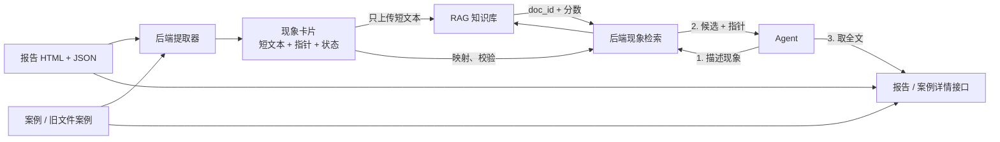
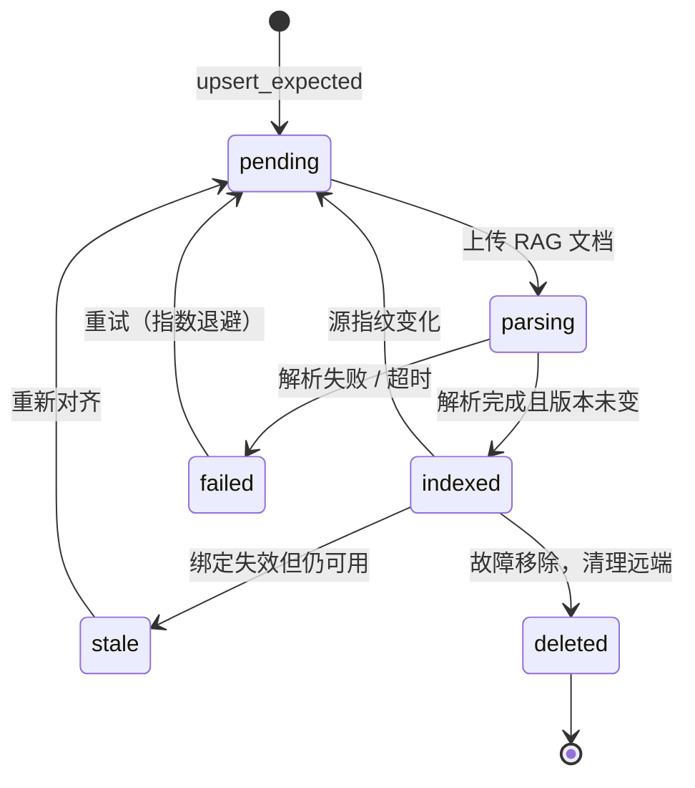
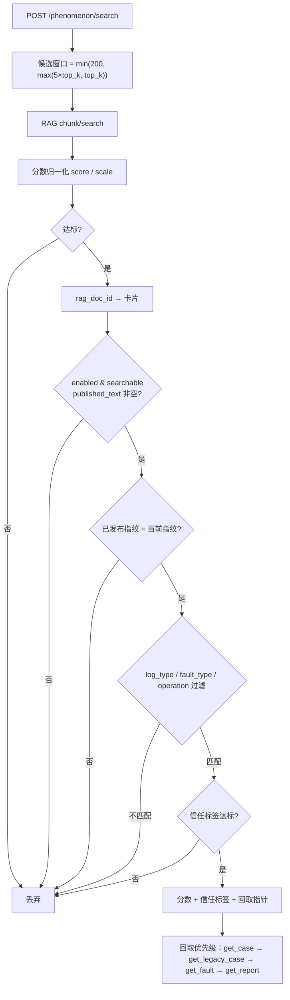
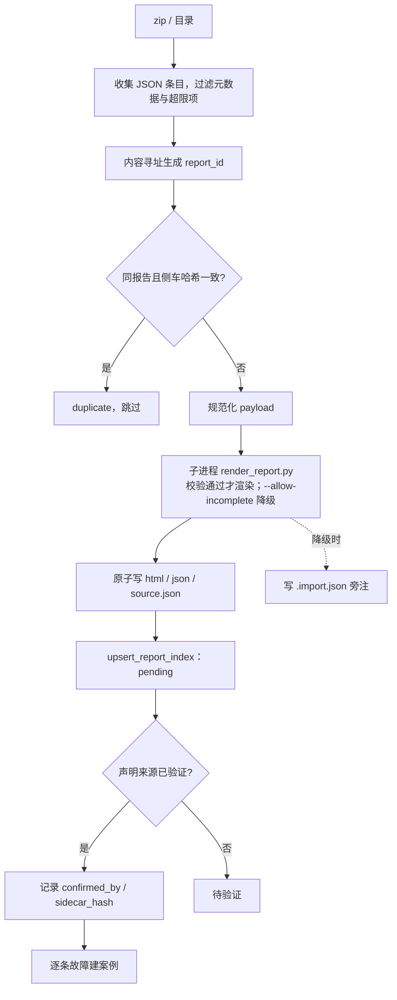

# 报告、案例与现象检索整合设计

状态：已实现并上线（定界文档中心为当前产品契约）。
范围：诊断报告库、超节点案例库（`diag_case_library`）、旧文件案例库（`/case_library`）、现象卡片与 RAG 检索。
一句话：**报告和案例继续保存全文；RAG 只保存「现象卡片」；Agent 用现象查相似度，拿到指针后再回取完整报告或案例。**

---

## 1. 目标与边界

### 1.1 要解决的问题

历史经验分散在三个互不连通的存储里：报告只有 HTML + 侧车 JSON，超节点案例只能按结构化信号检索，
旧文件案例只有自由文本。共同缺口是**没有按自然语言现象召回历史经验的通道**：

- 报告与案例全文太长，Agent 无法把历史全塞进上下文逐篇比对。
- 结构化信号检索擅长回答「信号是否相同」，不擅长「现象是否相似」。

### 1.2 三层分工

| 层 | 存什么 | 谁读 | 边界 |
| --- | --- | --- | --- |
| 详情层 | 报告 HTML + 侧车 JSON；案例完整记录；旧文件案例 | 人、Agent 按 ID 回取 | 内容完整，不进向量库 |
| 索引层 | 一条现象一张卡片（`phenomenon_index`） | 索引器、检索接口 | 只保留「现象像什么」与详情指针 |
| 检索层 | RAG 知识库中的卡片短文本 | Agent 经后端检索接口 | 只返回相似度与指针 |



### 1.3 非目标

| 非目标 | 处理 |
| --- | --- |
| 全文向量化 | 报告正文、HTML、原始日志、trace、IP 清单留在关系库 |
| 把 RAG 当业务库 | 检索只给相似度与指针，结论来自回取的详情 |
| 为旧文件案例补证据 | 只读适配，质量不足的文本不入索引 |
| 扩大确认粒度 | 确认只作用于当次对象：案例或某一版报告 |

---

## 2. 数据模型

### 2.1 表

| 表 | 职责 | 关键列 |
| --- | --- | --- |
| `diagnostic_report_index` | 报告级索引状态 | `report_id`、`index_status`、`report_available`、`confirmed_by` |
| `phenomenon_index` | 一条现象一张卡片，双缓冲发布 | `doc_id`、`content_hash`、`published_*`、`pending_*`、`index_status` |
| `rag_doc_cleanup_task` | 待删除的远端文档，按 `(rag_kb_id, rag_doc_id)` 幂等入队 | `status`、`reason`、`retry_count` |
| `index_event_outbox` | 业务状态变更事件 | `event_key`、`event_type`、`status`、`lease_expires_at` |
| `diag_case_library` / `_signal` | 案例主表与结构化信号；只做增量加列 | `source_report_id`、`source_fault_hash`、`operation`、`verification_json` |

时间列统一 `TIMESTAMP`（naive，取服务端 +08 墙钟）；租约与截止时间由数据库 `clock_timestamp()` 生成。

### 2.2 对象与 ID

| 对象 | ID | 说明 |
| --- | --- | --- |
| 报告 | `report_id` | 内容寻址，改名重传命中同一条 |
| 故障 | `source_fault_id` | 报告内稳定故障号；扁平报告规范化为 `F01` |
| 案例 | `case_id` / `case_no` | `case_no` 形如 `UB-CASE-000123`，对用户可见 |
| 卡片 | `doc_id` | `report:<report_id>:<fault_id>` / `case:<case_id>` / `legacy:<id>` |

### 2.3 派生列与指纹

- `content_hash`：卡片检索文本的哈希，变化才重新上传。
- `source_fault_hash`：源故障指纹，取自标题、结论、根因、状态码、故障模式等**稳定字段**，
  用于判断「案例是否仍绑定同一份报告故障」。
- 派生规则变更会改变指纹，必须同步按源报告重算（`reconcile` 内的案例修复），否则案例与卡片解绑退化 `stale`。

---

## 3. 现象卡片契约

### 3.1 字段分组

| 分组 | 字段 |
| --- | --- |
| 身份 | `doc_id`、`kind`、`content_source`、`report_id`、`source_fault_id`、`source_fault_hash`、`case_id`、`case_no`、`legacy_case_id` |
| 检索文本 | `title`、`symptom`、`root_cause_summary`、`text`、`content_hash` |
| 过滤元数据 | `log_type`、`operation`、`fault_type`、`status_codes`、`failure_mode_ids`、`verification`、`binding_status` |
| 发布 | `published_*`、`pending_rag_kb_id`、`pending_rag_doc_id`、`pending_content_hash`、`rag_kb_id`、`rag_doc_id`、`indexed_content_hash` |
| 健康 | `enabled`、`searchable`、`index_status`、`index_error`、`retry_count`、`next_retry_at`、`lease_owner` |

### 3.2 文本与脱敏

上传 RAG 的只有一段短文本：`标题。现象摘要。故障域。故障组件。状态码 xxx。`

- 现象摘要上限 600 字，整段硬上限 1200 字，超长按句截断（不含半句）。
- 身份信息按词表与正则替换为 `[IP]` / `[POD]` / `[主机]` / `[集群]` / `[文件]` / `[任务]` / `[TRACE]` 占位符；
  残留命中则整条卡片拒绝入库。
- 词表来自本次报告的 payload，不内置任何具体机器、IP、目录。

### 3.3 报告 JSON → 卡片

| 卡片字段 | 来源 |
| --- | --- |
| `title` | `faults[].title` |
| `symptom` | `conclusion.one_line_conclusion` + 前 3 条 `key_findings` |
| 故障域 / 组件 | `conclusion.fault_domain` / `fault_component` |
| `status_codes` | `fault.error.breakdowns[].code_distribution`（新报告）→ `evidence_traces`（次之）→ 单故障报告的 `statistics.top_error_codes` |
| `operation` | 有样本的阶段桶操作；否则取报告级标签中 `（` 前的操作头；两者冲突记为 `MIXED` |
| `fault_type` / 标签 | `category` 与 `conclusion` 的两级标签 |
| `verification` / `binding_status` | 查询时按案例与报告当前状态**实时派生**，不落库为事实 |

### 3.4 不上传什么

报告正文、HTML、处置步骤、验证记录、原始日志、trace、IP 清单、案例的结构化信号。
需要精确过滤、审计或现场核对的内容留在关系库。

---

## 4. 索引与发布

### 4.1 后台作业

开关 `PHENOMENON_INDEX_ENABLED` 打开才注册（部署层留空 = 检测到 RAG 即开）。

| 作业 | 周期 | 作用 |
| --- | --- | --- |
| `scan_reports` / `scan_legacy` | `RAG_INDEX_INTERVAL`（默认 120s） | 扫描报告卷与旧案例，补齐期望卡片 |
| `consume_events` | `RAG_EVENT_INTERVAL`（默认 5s） | 消费 outbox：案例确认 / 归档 / 闭环 / 报告删除 |
| `publish_due_cards` | 同上 | 认租约 → 上传 → 轮询解析 → 登记映射 |
| `resume_parsing_cards` | 同上 | 续跑中断的解析 |
| `cleanup_documents` | `RAG_CLEANUP_INTERVAL`（默认 60s） | 删除远端无用文档 |
| `reconcile` | `RAG_RECONCILE_INTERVAL`（默认 86400s） | 全量对账与自愈；启动时也跑一次 |

### 4.2 双缓冲发布

```text
upsert_expected(文本或指纹变化 → pending) → 认租约 → 上传 phenomenon_<sha16>.txt
   → 轮询解析成功 → 校验 pending_content_hash 仍是最新 → 原子切换 published_* → searchable=true
```

期望版本与已发布版本分离，避免并发上传把旧版本标成已索引：切换前必须比对
`pending_content_hash` 与 `content_hash`，不一致就丢弃本轮结果重新排队。

### 4.3 状态机



### 4.4 触发时机

| 触发 | 事件 | 结果 |
| --- | --- | --- |
| 报告导入完成 | 写 `diagnostic_report_index`（pending） | 扫描作业（≤120s）抽取期望卡片，发布作业（5s）上传 |
| 案例确认 / 归档 / 闭环 | `index_event_outbox` | 5s 内消费，卡片文本与信任标签更新 |
| 报告文件删除 | `report_deleted` | 卡片退化为案例来源或 `stale`，案例 `source_report` 变 `deleted` |
| 报告被新版本替换 | 归档旧报告 | 旧卡片 `deleted`，对应案例归档，新报告的案例号顺延 |

### 4.5 对账与自愈

`reconcile` 修九类偏差：源漂移（`drift`）、映射非法（`invalid`）、解析卡死（`stuck`）、
远端文档缺失（`missing`）、远端孤儿（`orphans`，含墓碑过滤）、换知识库后的旧映射（`stale_kb`）、
被替换报告的状态归并（`superseded_reports`）、案例派生列重算（`case_repaired`）、
过期操作信号清理（`signals_dropped`）。

换知识库、删库后重建都能自愈：映射指向旧 `kb_id` 时退役重发，远端文档不存在时清映射重排。

---

## 5. 检索与回取

### 5.1 流程



### 5.2 分数与过滤

- `score` 只作排序，不作采用依据；一次检索有 4.5s 硬预算，超时返回 503。
- `operation` 是纯过滤器：`MIXED` 与未标注的卡片对 GET / SET 都成立；`N/A` 不参与过滤。
- 案例侧的结构化检索（`/diag_case_library/search`）按结构化信号匹配，`operation`
  同样只做排除性过滤，不参与计分。

### 5.3 信任标签

| 标签 | 含义 | 可引用程度 |
| --- | --- | --- |
| `verified` | 案例已闭环（`closed_loop=true`） | 可参考处置 |
| `confirmed_unverified` | 案例已确认，处置未回填 | 上限 adjust |
| `report_only` / `suspected` / `legacy_unverified` / `task_observed` | 只有报告、旧案例或任务观测线索 | 仅线索 |

`binding_status=stale` 表示案例与报告当前版本已对不上，按线索使用。

### 5.4 降级

| 场景 | 表现 | 处理 |
| --- | --- | --- |
| RAG 不可达 / 超时 | 503 | 回退结构化案例检索；不得当成「无历史」 |
| 无命中 | 200 + `matches=[]` | 记「库内无先例」；系统健康看 `/phenomenon/status` |
| 契约异常 | 2xx 但字段缺失或分数越界 | 视为依赖故障上报 |

---

## 6. 导入、确认与建案

### 6.1 导入

三个入口：镜像内置归档（启动自动）、页面上传 zip / JSON、服务器路径导入（限定允许根目录）。



- **渲染在子进程**：`report_id` 与侧车哈希由渲染器产出，内存 patch 无效。
- **质量旁注独立成文件**：侧车参与 `sidecar_hash`，混入质量信息会让已确认报告被判成「版本已变化」。
- **字段不全可降级**：缺失区块按模板空白渲染，缺项写进案例 `scope_limits`，复现前须回看原报告。

### 6.2 确认

确认针对**整份报告的当前版本**，需带 `expected_sidecar_hash`，防止确认到渲染中途的版本。
确认只表示「内容可信」，不表示处置已执行。

### 6.3 建案与闸门

| 闸门条件 | 说明 |
| --- | --- |
| 证据非空 | `evidence_json` 至少一条可回指的锚点 |
| 处置非空 | `remediation_json` 至少一步 |
| 至少一个可匹配信号 | 错误码 / 故障模式 / 时延组件 / 日志关键词 / 主机 / Pod / IP / 集群任一 |

闸门**只判「报告可信」**。出稿时处置尚未执行，闭环在案例确认之后由 verify 接口单独回填。
缺项时保持 `draft` 并返回缺失字段名。

### 6.4 闭环

`verification_json.closed_loop=true` 是独立维度，通过 verify 接口回填（乐观锁
`expected_revision`，每次 `revision+1`）。只有闭环案例才允许 `applicability=direct`。

---

## 7. 不变量与失败行为

1. **报告卷是唯一事实来源**：文件被删，卡片指针降级、案例 `source_report` 变 `deleted`。
2. **一张卡片对应一条现象**：多故障报告按 `faults[]` 拆卡，不造 `F01:GET` 这类复合键。
3. **发布前必须校验版本**：`pending_content_hash` 与 `content_hash` 不一致就丢弃结果。
4. **索引是最终一致的**：刚确认的案例不会立刻可检索（事件消费 5s，全量扫描 120s）。
5. **失败可见**：`index_status` + `index_error` + `/phenomenon/status` 三处都能看到失败原因与重试时间。
6. **信任标签只按回填升级**：`confirmed_unverified` 需真实闭环回填才变成 `verified`。

---

## 8. 配置与验收

### 8.1 配置

| 变量 | 默认 | 作用 |
| --- | --- | --- |
| `PHENOMENON_INDEX_ENABLED` / `PHENOMENON_SEARCH_ENABLED` | 留空 = 检测到 RAG 即开 | 索引 / 检索开关 |
| `RAG_CORE_URL` / `RAG_ACCESS_KEY_FILE` | 部署注入 | RAG 地址与密钥文件 |
| `RAG_PHENOMENON_KB_ID` | 首次部署自动创建 | 现象专用知识库 |
| `RAG_EMBEDDING_ENDPOINT` / `MODEL_NAME` / `DIMENSION` / `API_KEY` | `BAAI/bge-m3` / 1024 | embedding 端点与模型，随密钥一起落盘 |
| `RAG_MIN_SCORE` / `RAG_TOP_K` / `RAG_SCORE_SCALE` | 0.1 / 5 / 100 | 检索阈值、召回数、分数归一化 |
| `RAG_INDEX_INTERVAL` / `RAG_EVENT_INTERVAL` / `RAG_CLEANUP_INTERVAL` / `RAG_RECONCILE_INTERVAL` | 120 / 5 / 60 / 86400 s | 作业周期 |

换 embedding 模型或维度必须重建索引（`POST /phenomenon/index`，`scope=all`，`force=true`），
否则新旧向量混在同库，检索静默降质。

### 8.2 验收

| 验收项 | 判定 |
| --- | --- |
| 内置报告导入 | `/phenomenon/status` 的 `reports.by_status.indexed` 与 `cards.searchable` 收敛到总数 |
| 卡片契约 | 单测覆盖截断、脱敏、状态码优先级、`operation` 派生 |
| 全文隔离 | 检查实际上传载荷与 RAG 存储内容 |
| 删除一致性 | 删报告文件后卡片降级、案例指向 `deleted`、对账无残留孤儿 |
| 换库自愈 | 换 `RAG_PHENOMENON_KB_ID` 后重启，旧映射退役、卡片重发、检索恢复 |
| 检索可用性 | RAG 断开时 `/phenomenon/search` 返回 503，结构化检索仍可用 |
